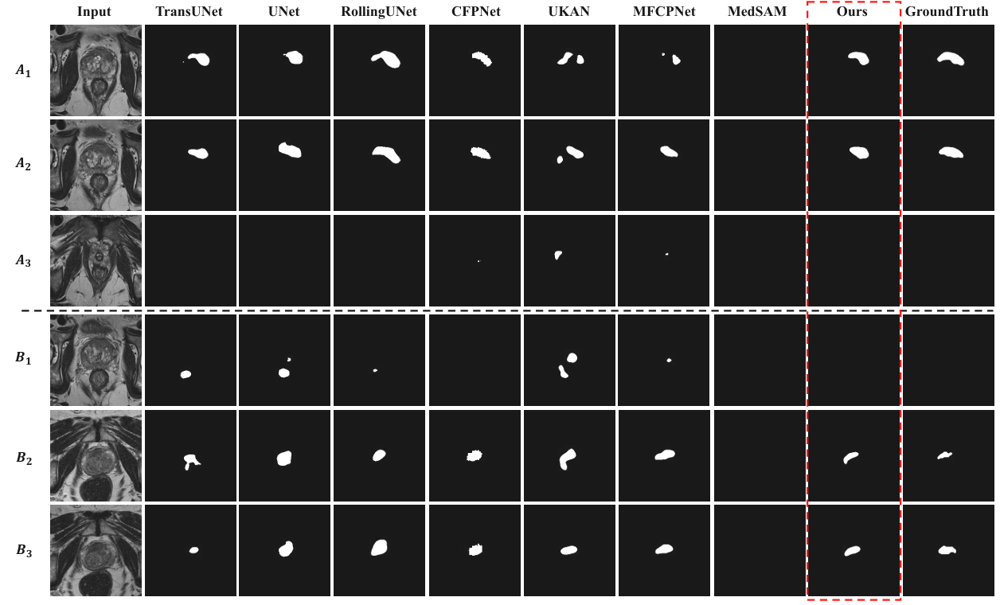

🧠 MyGO: Make Your Goals Obvious

MyGO is a deep learning model for prostate cancer MRI segmentation that avoids semantic confusion by selectively modeling key global features. It introduces a novel Pixel Fulcrum Module and integrates self-attention with Top-k selection to enhance feature interpretation while reducing computational redundancy. The architecture is built upon a U-KAN backbone and leverages KAN Layers for nonlinear semantic learning.

🎯 Highlights

Pixel Anchor Module: Learns sparse anchors to capture semantic context.

Top-k Attention: Selects the most relevant anchor features.

Focal Loss Integration: Addresses class imbalance in small lesion regions.

U-KAN Framework: Strong modeling for high-order nonlinear features.

SOTA Performance: Achieved 69.73% mIoU and 74.32% Dice on the PI-CAI dataset.

| Method       | mIoU (%) | Dice (%) | Specificity (%) | FPR (%) |
|--------------|----------|----------|-----------------|---------|
| U-Net        | 24.00    | 35.64    | 99.57           | 0.43    |
| RollingUnet  | 43.31    | 54.65    | 99.66           | 0.21    |
| U-KAN        | 66.82    | 72.94    | 99.66           | 0.21    |
| MyGO         | 69.73    | 74.32    | 99.87           | 0.13    |

## Checkpoint

You can download the checkpoint from [checkpoints/ours.pth](checkpoints/ours.pth).

## Run the notebook

You can run [inference.ipynb](inference.ipynb) in VS Code or Jupyter.

1. Download or clone this repository and open the notebook.
2. Select a Python 3.12 kernel. Install the dependencies listed in the first code cell, then restart the kernel.
3. Set ROOT to your MyGO folder and DATA_ROOT to the prepared data folder containing images/ and masks/0/.
4. Select **Run All**. The notebook verifies the input files, loads the checkpoint, runs CPU inference, and displays an example prediction.
5. Find the CSV and JSON results in local_results/.

The notebook includes the model definitions required by this checkpoint. It has been tested on the prepared 256-by-256 PNG inputs for PI-CAI patients 11256 and 11382.

You can find these patients in MR-images7.zip and their labels in label_lesions.zip in the [public dataset repository](https://github.com/LZC0402/Dataset). The public PNGs have different dimensions and filenames. Conversion instructions for reproducing the verified inputs are **Coming soon**; this notebook currently requires the prepared data described inside the notebook.

Further code and documentation: **Coming soon**.
